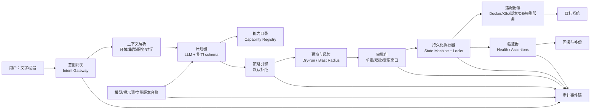
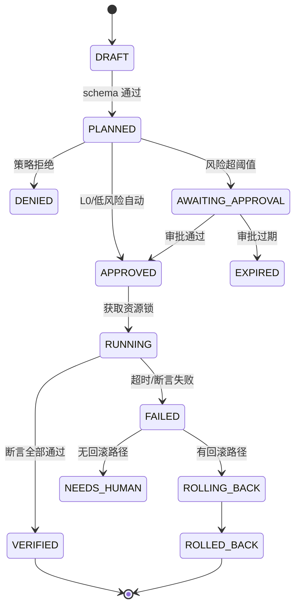

# 语控台 OpsTalk：自然语言运维控制面

> 概念设计讨论稿 · 2026-11-18  
> 这不是现有系统的说明书，而是一套“把语言变成受约束操作入口”的产品与架构提案。

## 0. 结论先行

**自然语言应该成为操作入口，但绝不能直接成为执行权限。**

这套产品的核心不是“让大模型会敲命令”，而是把一句话拆成：

```text
意图 → 上下文 → 能力计划 → 策略判定 → 预演/风险 → 审批 → 执行 → 验证/回滚 → 审计
```

三条硬边界：

1. **模型只提案，策略和执行器才拥有决定权。** 大模型不直接持有 shell、数据库或集群凭据。
2. **默认拒绝，能力白名单。** 只允许登记过的查询、单服务重启、白名单脚本变更、整套系统启动；任意 shell、删数据、改密钥、改网络/IAM 永久拒绝。
3. **后果必须可接受。** 每个动作都要有影响范围、预演结果、验证断言和回滚路径；没有回滚路径的动作不允许自动执行。

推荐 MVP 架构：**模块化单体控制面 + PostgreSQL 持久化状态机 + Redis 锁/队列 + 适配器层**。不是微服务，也不是“多 Agent 自治集群”。

---

## 1. 背景与机会

### 1.1 现状

现在的操作方式已经验证了一条路径：人用自然语言告诉豆包，豆包再调用系统工具完成查询、构建、部署、重启、改脚本、看日志。它有效，但依赖三样东西：

- 操作者记得系统拓扑、端口、容器名、队列名和先后顺序；
- 操作者知道哪些动作危险、哪些可以重试；
- 操作者本人在现场，能随时判断“这句话到底会动到什么”。

这套能力目前更像“个人外挂”，还不是产品。

### 1.2 真正的痛点

| 痛点 | 具体表现 | 产品机会 |
| --- | --- | --- |
| 入口成本高 | 查一个队列要开终端、进容器、记 Redis key；重启要翻 compose 文件 | 一句话完成查询和受控动作 |
| 知识在个人脑子里 | runbook 散落在聊天记录、脚本注释、临时文档 | 把操作知识固化成能力目录与预演 |
| 权限边界模糊 | “帮我重启一下”可能重启一个、也可能重启一组 | 用能力级别、资源范围和审批把歧义消掉 |
| 结果不可验证 | 命令返回 0 不等于服务真的恢复 | 执行后强制健康断言与证据留存 |
| 复盘成本高 | 谁在什么时候因为哪句话改了什么，很难还原 | 意图、计划、策略、diff、审批、结果全链路审计 |

### 1.3 目标客户

- 5–50 人的中小团队，运维/后端/创始人兼任值班；
- 多集群、多项目、混合 Docker/K8s/裸机环境；
- 有明确“不能出事”的诉求，但又没有预算养一套重型自治运维平台；
- 希望把资深运维的判断力复制给一线同学，而不是让一线同学直接拿生产 root。

### 1.4 不做什么

- 不做任意命令执行器；
- 不做无人值守的“AI 运维机器人”；
- 不做跨云、跨账号的全自动编排；
- 不做数据删除、密钥轮换、网络策略、IAM 变更；
- 不把模型评估结果当作唯一发布门禁。

---

## 2. 需求

### 2.1 角色

| 角色 | 能做什么 | 不能做什么 |
| --- | --- | --- |
| Viewer | L0 查询、看审计 | 任何变更 |
| Operator | L0 + L1 单服务动作 | L2/L3、看密钥 |
| Change Manager | 审批 L2/L3、查看 diff | 绕过策略、直接执行 |
| Incident Commander | 故障模式下调用预批准 runbook | 任意扩大资源范围 |
| Admin | 维护能力目录、策略、适配器 | 不能修改审计记录 |

### 2.2 功能需求

| 编号 | 能力 | 说明 |
| --- | --- | --- |
| F1 | 自然语言意图 | 文本输入；语音作为后续入口，不改变权限模型 |
| F2 | 上下文补全 | 解析环境、集群、服务、时间范围；歧义时追问，不猜 |
| F3 | 能力目录 | 每个动作有 schema、前置条件、影响、回滚、审批级别 |
| F4 | 计划生成 | 只从能力目录组合步骤；禁止自由 shell |
| F5 | 策略判定 | RBAC + ABAC + 环境/变更窗口/风险预算；默认拒绝 |
| F6 | 预演 | 拓扑影响、diff、预计停机、回滚时间、验证断言 |
| F7 | 审批 | 审批绑定计划 hash；双人审批用于 L2/L3；审批过期 |
| F8 | 执行 | 持久化状态机、幂等键、资源锁、超时、熔断、补偿 |
| F9 | 验证 | 健康检查、接口断言、队列/错误率/资源指标 |
| F10 | 回滚 | 配置/脚本快照、镜像版本、服务重启、特性开关 |
| F11 | 审计 | 不可变事件链；记录模型、提示词、工具 schema、策略版本 |
| F12 | 可视化 | 指挥台、审批箱、拓扑、执行时间线、版本台账 |
| F13 | 版本治理 | 软件、模型、参数、提示词、向量方案统一 manifest |
| F14 | 复盘 | 从一次执行生成事故记录与 runbook 候选，不自动改策略 |

### 2.3 能力边界

| 级别 | 允许的动作 | 默认策略 | 审批 | 回滚 |
| --- | --- | --- | --- | --- |
| L0 查询 | 状态、日志、指标、队列、GPU、容器、配置只读、备份列表 | 自动放行 | 无 | 不需要 |
| L1 单点变更 | 重启一个无状态服务、重排一个失败任务、清缓存、暂停队列、日志轮转 | 允许，限单资源 | 1 人 | 重启/恢复队列 |
| L2 脚本/配置变更 | 白名单目录内的非敏感脚本、启动参数、非密钥配置 | 预演 + diff + 备份 | 2 人 | 快照回滚 |
| L3 整套启动/停止 | 按依赖顺序启动全套系统、停机维护、灾备切换演练 | 变更窗口 + 健康门禁 | 2 人 + 值班确认 | 反向停机/恢复 |
| 禁止 | 任意 shell、删数据/卷、改密钥、改防火墙/IAM、DB schema、批量重启、外部写操作、生产凭据导出 | 永久拒绝 | 不可审批 | 不适用 |

**“不敏感脚本”的定义**：位于登记过的 `scripts/ops/` 或 runbook 目录；不含密钥、账号、外部网络写操作；静态扫描无危险命令；有语法检查、diff、沙箱预演、内容 hash、备份和回滚；执行前后都有断言。满足不了就不算“不敏感”。

### 2.4 非功能需求

| 维度 | MVP 目标 |
| --- | --- |
| 可用性 | 控制面 99.9%；控制面故障不阻塞现有系统运行 |
| 响应 | 意图解析 p95 < 2s；计划生成 p95 < 5s；L0 查询 p95 < 3s |
| 安全 | 未审批变更 0；禁止动作拒绝率 100%；秘密不进入模型上下文 |
| 可靠性 | 审计 RPO = 0；控制面 RTO < 15 分钟；回滚演练成功率 99% |
| 并发 | 单环境同时执行动作 ≤ 10；同一资源串行锁 |
| 可观测 | 每个动作有 trace_id、计划、策略、审批、执行、验证证据 |
| 成本 | 模型调用按任务预算；L0 查询优先走确定性接口，不用大模型绕一圈 |

### 2.5 约束

- MVP 单区域、3–5 个目标环境、20–30 个能力；
- 复用现有 Docker/Compose、Redis、PostgreSQL，不先上 Kafka/Temporal；
- 生产变更至少双人审批；
- 模型可以换，但**能力 schema、策略、审计格式不能随模型漂移**；
- 任何自动化都不能绕过现有备份、监控和变更窗口。

---

## 3. 总体架构



### 3.1 组件职责

| 组件 | 职责 | 关键约束 |
| --- | --- | --- |
| 意图网关 | 接收文字/语音，做脱敏、限流、会话绑定 | 不直接持有任何执行凭据 |
| 上下文解析 | 把“它/那个/再重启一下”落到具体资源 | 歧义必须追问，不默认猜生产 |
| 能力目录 | 登记能力、参数 schema、风险、回滚、审批 | 目录外动作一律不可执行 |
| 计划器 | 用 LLM 生成候选步骤，调用 schema 校验 | LLM 只能提案，不能改策略 |
| 策略引擎 | RBAC/ABAC、环境、窗口、风险、预算 | 独立于模型；默认拒绝 |
| 预演器 | 拓扑影响、diff、停机估算、回滚时间 | 预演不产生副作用 |
| 审批门 | 绑定 plan_hash、双人、过期、不可复用 | 审批不是“同意这句话”，是“同意这个计划” |
| 执行器 | 状态机、幂等、锁、重试、超时、补偿 | 非幂等步骤禁止盲重试 |
| 适配器 | 把能力翻译成 Docker/K8s/脚本/DB 调用 | 最小权限、短时凭据、网络白名单 |
| 验证器 | 执行后断言，不通过则回滚/停机 | 验证失败不能只发一条告警 |
| 审计 | append-only 事件链，记录证据 | 不可篡改；模型输出可追溯 |
| 可视化 | 指挥台、审批、拓扑、时间线、版本 | 每个数字可下钻到证据 |

### 3.2 为什么不是微服务

MVP 阶段最重要的是**计划、策略、审计的一致性**。把策略引擎、执行器、审批拆成多个服务，会先引入分布式事务、消息重复、版本漂移和调试成本，而团队规模还不足以消化。

采用模块化单体：

- 一个 FastAPI 进程内按模块隔离：intent / policy / planner / executor / audit；
- 长任务由独立 worker 执行；
- PostgreSQL 保存状态机与审计，Redis 做锁和队列；
- 适配器层独立接口，未来可以按环境拆出服务；
- 当单环境动作量 > 1000/天或需要多团队独立发布时，再拆策略服务和执行服务。

### 3.3 核心数据表

| 表 | 作用 |
| --- | --- |
| `capabilities` | 能力目录、schema、风险、回滚、审批级别 |
| `action_requests` | 原始意图、脱敏文本、会话、用户 |
| `plans` | 计划 hash、模型版本、prompt 版本、上下文快照 |
| `plan_steps` | 能力、参数、依赖、超时、补偿 |
| `policy_decisions` | 允许/拒绝/需审批、命中的规则、风险分 |
| `approvals` | 审批人、plan_hash、有效期、双人记录 |
| `runs` | 状态机、幂等键、锁、开始/结束、失败原因 |
| `run_events` | append-only 执行事件、证据、hash chain |
| `snapshots` | 脚本/配置/镜像版本快照 |
| `release_manifests` | 软件 + 模型 + 提示词 + 向量方案版本 |

### 3.4 执行状态机



---

## 4. 关键决策（ADR）

### ADR-001：采用能力型控制面，而不是自由工具调用 Agent

**状态**：提议  
**背景**：聊天式 Agent 可以直接调用 shell/HTTP，灵活但后果不可预测。运维场景的核心不是“能做多少”，而是“做错时能不能兜住”。  
**决定**：所有动作登记为 capability，带参数 schema、前置条件、风险、审批、验证、回滚；模型只能在目录内组合。  
**替代方案**：

- 纯工具调用 Agent：灵活，但无法做稳定权限与回滚，拒绝；
- 纯表单自动化：安全，但失去自然语言入口价值，作为底层能力保留；
- 能力目录 + LLM 计划：推荐。

**代价**：能力目录维护成本；新动作上线需要评审。  
**收益**：可预测、可审计、可回滚；模型升级不改变安全边界。

### ADR-002：MVP 用模块化单体 + PostgreSQL 状态机

**状态**：提议  
**背景**：团队小，需要先跑通“意图→计划→审批→执行→验证”闭环。  
**决定**：单进程模块化 + worker + PostgreSQL 状态机 + Redis 锁；不上 Kafka/Temporal。  
**替代方案**：

- 微服务：隔离好，但分布式复杂度高；
- Temporal：持久化工作流强，但学习和运维成本高，等 L3 多环境编排再评估。

**代价**：单进程故障会影响控制面；用无状态副本 + 数据库恢复解决。  
**收益**：一致性强、调试简单、上线快。

### ADR-003：策略引擎独立于模型，默认拒绝

**状态**：提议  
**决定**：模型输出只是 `plan_candidate`；策略引擎用确定性规则做最终判定，规则版本化、可测试。  
**原因**：提示词注入、日志注入、模型幻觉都不能直接影响权限。  
**代价**：需要维护规则和策略测试集；收益是安全边界稳定。

### ADR-004：分级审批，审批绑定计划而非句子

**状态**：提议  
**决定**：L0 自动；L1 单批；L2/L3 双批；审批记录绑定 `plan_hash`，计划变化即失效。  
**原因**：用户同意的是“这个计划”，不是“这句模糊的话”。  
**代价**：审批步骤增加；用风险分级和只读自动放行控制疲劳。

### ADR-005：软件、模型、提示词、向量方案统一版本清单

**状态**：提议  
**决定**：每次发布生成不可变 `release_manifest`，把代码、镜像、模型、参数、提示词、工具 schema、能力目录、策略包、embedding 模型、chunking、向量索引版本绑定。  
**原因**：只看 Git SHA 无法复现“为什么这次回答/计划变了”。  
**代价**：发布流程更重；收益是任何一次事故都能精确回放。

---

## 5. 风险、预演与可靠性

### 5.1 风险分

```text
risk = 0.40 × (1 - reversibility)
     + 0.25 × blast_radius
     + 0.20 × data_mutation
     + 0.15 × environment_criticality
```

- `reversibility`：1 表示一键回滚，0 表示不可逆；
- `blast_radius`：受影响服务/队列/数据量归一化；
- `data_mutation`：是否写业务数据或删文件；
- `environment_criticality`：dev/staging/prod/生产核心。

建议阈值：

| 分数 | 策略 |
| --- | --- |
| < 0.25 | L0/低风险 L1 自动执行 |
| 0.25–0.55 | 单审批 + 预演 |
| 0.55–0.80 | 双审批 + 预演 + 变更窗口 |
| > 0.80 | 默认拒绝；仅预批准 break-glass runbook |

风险分不是“安全证明”，只是审批路由。真正的兜底是预演、锁、验证和回滚。

### 5.2 预演必须回答的问题

1. 影响哪些服务、队列、数据卷、上游/下游？
2. 会不会中断正在跑的任务？预计停机多久？
3. 改动 diff 是什么？能否一键回滚？回滚需要多久？
4. 执行后用什么断言判断成功？
5. 失败时自动回滚还是停下来等人？
6. 当前是否在变更窗口？是否已有同资源动作在跑？

### 5.3 可靠性设计

- **幂等键**：同一意图重复点击不会重复重启/重复改脚本；
- **资源锁**：同一服务/队列/目录串行，避免两个操作互相踩；
- **持久化状态机**：进程重启后从最后一个 checkpoint 继续或安全停止；
- **重试分级**：只对只读、幂等步骤自动重试；重启最多一次；脚本变更不自动重试；
- **超时与熔断**：每步超时；连续失败触发熔断，停止后续步骤；
- **验证门禁**：health、接口、队列、错误率、资源指标；任一失败进入回滚；
- **补偿动作**：L2 用快照回滚；L3 用反向停机顺序；L1 用恢复队列/重启；
- **全局急停**：一个开关停止所有未开始的执行；
- **审计 hash chain**：事件不可静默修改；导出给外部 SIEM。

### 5.4 主要失败模式

| 失败 | 后果 | 处理 |
| --- | --- | --- |
| 模型幻觉出不存在的服务 | 计划错误 | schema + 资源存在性校验；歧义追问 |
| 日志里藏提示词注入 | 模型被诱导调用危险工具 | 日志只作为数据；工具调用必须过策略；能力目录不可由模型改 |
| 审批后计划被替换 | 批的是 A，执行的是 B | 审批绑定 plan_hash；执行前重算 hash |
| 执行到一半进程崩溃 | 半完成状态 | 持久化 checkpoint；恢复时先验证再继续/回滚 |
| 验证失败但没回滚 | “命令成功，服务仍坏” | 验证器强制执行回滚或转人工 |
| 审计被改 | 无法追责 | append-only + hash chain + 外部备份 |
| 多集群配置漂移 | 同一句话结果不同 | 适配器契约测试 + 环境能力矩阵 |

---

## 6. 可视化：控制室而不是报表墙

可视化页面要回答四件事：**现在是什么状态、这句话会被理解成什么、执行到哪一步、出了事看哪条证据。**

### 6.1 五个固定区域

| 区域 | 内容 | 交互 |
| --- | --- | --- |
| 指挥输入 | 自然语言、示例、上下文选择 | 发送后先显示“解析结果”，不直接执行 |
| 计划与策略 | 能力、参数、风险分、允许/拒绝/待审批 | 展开每一步，查看命中的规则 |
| 拓扑与影响 | 集群、服务、队列、依赖边 | 高亮受影响范围；点击看证据 |
| 执行时间线 | 预演→审批→执行→验证→回滚 | 实时事件流；失败步骤红色 |
| 审批/审计 | diff、审批人、plan_hash、证据 | 双人审批；审计可导出 |

### 6.2 状态语义

- 蓝色：运行中/已批准/正常流动；
- 灰色：空闲/未启动/只读；
- 琥珀：等待审批/风险提示/降级；
- 红色：失败/拒绝/回滚；
- 不用颜色单独表达状态，必须同时有文字和图标。

### 6.3 反模式

- 把“聊天窗口”当全部产品；
- 数字很多但没有下钻证据；
- 审批只显示一句“是否同意”，不显示 diff 和影响；
- 用动画掩盖状态不确定；
- 把“执行成功”当成“服务恢复”。

---

## 7. 版本治理：软件、模型、提示词、向量方案一起管

### 7.1 发布清单

```json
{
  "release_id": "opstalk-1.0.0",
  "git_sha": "…",
  "backend_image_digest": "sha256:…",
  "frontend_build": "…",
  "model": {
    "provider": "…",
    "model": "…",
    "revision": "…",
    "quantization": "…"
  },
  "inference": {
    "temperature": 0.1,
    "top_p": 0.9,
    "max_tokens": 4096
  },
  "prompt_version": "planner-v7",
  "tool_schema_version": "capabilities-v3",
  "output_schema_version": "plan-output-v2",
  "policy_bundle_version": "policy-v5",
  "embedding_model": "…",
  "chunking_version": "…",
  "vector_index_version": "…",
  "eval_report_hash": "…",
  "approval_record": "…"
}
```

### 7.2 两类评估必须分开

| 类型 | 评估对象 | 方法 | 失败后果 |
| --- | --- | --- | --- |
| AI 链路质量评估 | 意图识别、计划正确性、工具选择、参数、拒答、解释 | 黄金集、对抗集、LLM judge + 人工抽检 | 计划错、误操作、乱拒答 |
| 软件功能质量测试 | API、状态机、权限、幂等、并发、故障注入、回滚、性能 | 单元/集成/E2E、契约测试、压测、混沌测试 | 系统 bug、状态不一致 |

**LLM judge 不能单独作为发布门禁**；它适合做质量信号，最终要有确定性测试和人工签字。

### 7.3 0.9 与 1.0 的门禁

| 版本 | 必须满足 |
| --- | --- |
| 0.9 | 确定性 CI 全绿；黄金集与对抗集达标；无 P0/P1；已知问题清单；自测自评收敛；staging 金丝雀通过 |
| 1.0 | Kimi 独立评估与测试通过；权限/回滚/并发/故障注入通过；人工复核；回滚演练成功；产物签名并上传 |

---

## 8. 预演：如果让我来做，我会怎么做

### 8.1 先定三个候选架构，做互评

| 候选 | 描述 | 判断 |
| --- | --- | --- |
| A. Chat + 工具调用 Agent | 语言直接调用 shell/HTTP，最灵活 | 拒绝：爆炸半径不可控，无法稳定审批与回滚 |
| B. 能力型控制面 | 能力目录 + 策略 + 预演 + 持久化执行 | **推荐**：安全、可审计、可渐进扩展 |
| C. 事件驱动自治集群 | 多 Agent 订阅事件、自动处置 | 暂缓：适合作为 L0 告警关联/L1 建议，不适合 MVP 主执行链 |

架构互评使用同一份需求、约束、候选图和 ADR，交给 Claude/GPT 的最好模型，再加 Kimi/DeepSeek 等作为独立评审；每个评审独立输出：

- 致命缺陷（一票否决项）；
- 8 个维度评分：安全、可靠性、可运维、可测试、复杂度、成本、扩展性、交付速度；
- 与候选 B 的差异和反对意见；
- 需要补充的证据。

规则：**同证据、盲评、记录模型/版本/提示词、保留分歧**；不由“多数投票”直接选，由人类架构负责人做最终决定并写 ADR。更多 LLM 只增加视角，不替代责任。

### 8.2 前端设计

先做信息架构，不先做视觉：

1. 指挥台：一句话 + 解析结果 + 风险；
2. 审批箱：diff、影响、回滚、plan_hash；
3. 拓扑：受影响范围和依赖；
4. 执行时间线：每一步的证据；
5. 版本台账：软件/模型/提示词/向量。

前端评审重点不是“好不好看”，而是：审批人能否在 30 秒内看懂“会发生什么、出了事怎么退”。

### 8.3 施工与收敛

- 用 DeepSeek V4.1 Flash 做主体施工；
- 按垂直切片交付：L0 查询 → L1 单服务重启 → L2 脚本变更 → L3 整套启动；
- 每个切片同时写：能力 schema、策略规则、预演、验证、回滚、测试；
- 每轮自测后做自评：计划正确率、策略误判、失败注入、审批可用性；
- 收敛后打 **0.9**，不直接宣称生产可用。

### 8.4 独立评估与 1.0

- Kimi 用不同提示词、不同测试集做独立评估，不看施工方的自评结论；
- 重点打：歧义指令、提示词注入、重复点击、并发冲突、半失败、回滚失败；
- 修复后打 **1.0**；
- 人工复核能力目录、策略、审批矩阵、回滚演练和审计样本；
- 上传 1.0 发布包与 manifest。

### 8.5 六周 MVP 节奏（估算）

| 周 | 交付 |
| --- | --- |
| W1 | 需求冻结、能力目录 v0、威胁模型、黄金指令集 |
| W2 | 架构互评、ADR、数据模型、策略骨架 |
| W3 | 控制室高保真、审批流、L0 查询闭环 |
| W4 | L1 单服务动作、锁/幂等/验证/审计 |
| W5 | L2 脚本变更、L3 整套启动、故障注入、回滚演练 |
| W6 | Kimi 独立评估、0.9→1.0、人工复核、发布 |

实际工期取决于目标环境数量、身份系统和现有适配器成熟度；这份节奏是设计预演，不是承诺。

---

## 9. 验收标准

### 9.1 功能验收

- 20 条黄金指令（查询/重启/脚本/整套启动/拒绝）能稳定生成正确计划；
- 歧义指令必须追问，不能默认选生产；
- L2/L3 没有双人审批不能执行；
- 同一资源并发动作被锁拒绝；
- 验证失败必须回滚或转人工，不能显示“成功”；
- 审计能还原：谁、何时、为什么、改了什么、结果如何。

### 9.2 AI 质量指标（建议门槛）

| 指标 | 目标 |
| --- | --- |
| 意图/资源识别准确率 | ≥ 95% |
| 计划步骤正确率 | ≥ 98% |
| 工具参数精确率 | ≥ 99% |
| 禁止动作拒绝率 | 100% |
| 无依据编造（服务/参数/结果） | < 2% |
| 审批解释可读性（人工抽检） | ≥ 90% |

### 9.3 软件质量指标

- 单元/集成/E2E 全绿；
- 状态机所有转移有测试；
- 故障注入：执行器崩溃、Redis 断连、目标超时、验证失败；
- 回滚演练：L1/L2/L3 各至少一次；
- 压测：单环境 10 并发动作不产生资源锁冲突错误；
- 安全：越权、重放、审批替换、日志注入全部拦截。

---

## 10. 风险与开放问题

### 10.1 产品风险

- **审批疲劳**：L1 太多会让人闭眼点同意；用风险分级和只读自动放行控制。
- **能力目录腐化**：脚本/环境变化后 schema 失真；用契约测试和环境巡检。
- **“一句话”被过度信任**：界面必须先展示计划，不能把自然语言当最终命令。
- **模型供应商变化**：模型可换，但能力/策略/审计格式必须稳定。

### 10.2 开放问题

1. 目标环境是 Docker Compose 为主，还是 K8s 多集群？
2. 身份系统用飞书/OIDC 还是独立账号？
3. 审批走飞书卡片、Web 控制台，还是两者同步？
4. “不敏感脚本”的白名单由谁维护、多久复核？
5. break-glass 的授权人是谁？是否允许单人紧急执行？
6. 审计保留多久？是否需要外部 WORM/SIEM？
7. MVP 是否允许语音入口，还是先只做文字？

---

## 11. 交付物

- 本设计文档：`自然语言运维控制面-设计方案.md`
- 交互式设计稿：`自然语言运维控制面-设计稿.html`

设计稿是概念预演，不连接真实系统，不执行任何命令。
