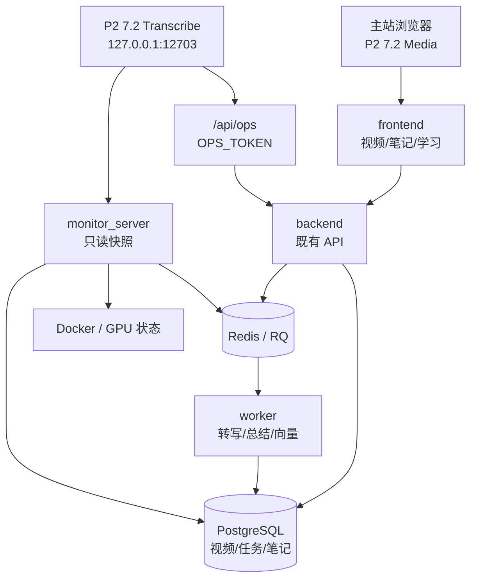

# P2 7.2 产品线拆分：Media / Transcribe / Lite

> 状态：P2 7.2 Media 与 P2 7.2 Transcribe 已落地；P2 7.2 Lite 已落地并合并到 `main`（2026-11-20 收尾）。
> 目标：把“看视频”和“生产字幕”拆成两个使用面，主站更稳定，转写变成显式本机运维动作。

## 1. 需求与边界

### 功能需求

- **P2 7.2 Media（主站）**
  - 保留：视频播放、字幕阅读与编辑、字幕内容检索、视频标题 / 文件夹检索、AI 总结只读展示、笔记、学习路径、日常与工具页。
  - 移除：转写页、AI 任务中心、转写设置入口、主站内的转写 / 校对 / 批量按钮、AI 任务轮询。
  - 数据仍然来自同一套 PostgreSQL / Redis / worker，不复制视频库或任务表。
- **P2 7.2 Transcribe（独立控制台）**
  - 独立进程、独立端口、只绑本机回环。
  - 手动输入视频库根目录或子目录，触发扫描。
  - 按范围筛选候选视频（无字幕 / 缺总结 / 未完成 / 全部），预览后批量入队。
  - 暂停 / 恢复 AI 队列；保留转写、向量、总结、ETA、worker 监控。
  - 所有写操作经后端受控接口；控制台不直接写数据库。
- **P2 7.2 Lite（已落地）**
  - 2GB 内存目标，砍掉视频与视频检索。
  - 主要能力收敛到 Agent、题目学习、笔记与学习路径。
  - 已在 `feat/p2-lite` 实现并合并 `main`；具体页面清单、共享库和内存验收见 [2026-11-20-p2-7.2-lite.md](2026-11-20-p2-7.2-lite.md)。

### 非功能需求

- 主站首屏与视频页不再因转写任务轮询产生额外请求。
- 控制面默认不暴露到局域网 / 公网；令牌为空时关闭而不是降级放行。
- 子目录扫描不能误删库内其他目录记录。
- 控制台与主站共用后端业务规则；重复投递、已完成判断、队列暂停行为保持一致。

## 2. 架构

关键点：**控制面搬出去，数据面不复制**。P2 Transcribe 是主站后端的运维前端，不是第二套流水线。

## 3. ADR

### ADR-001：转写做成独立控制面，不做独立数据面

**状态**：Accepted

**背景**：主站和转写页共用 `videos`、`ai_jobs`、RQ 队列和 worker。把转写完全复制成另一套程序，会带来双写、状态不一致和重复 worker 的问题。

**决策**：保留同一套后端与队列；新增独立控制台进程，只负责触发和监控。主站移除转写 UI 与轮询。

**后果**：
- 正向：任务状态、幂等判断、队列暂停规则只有一份；主站请求量下降。
- 负向：控制台仍依赖主后端可用；后端故障时控制台只能只读监控。

### ADR-002：控制台使用 OPS_TOKEN，不走用户 Cookie

**状态**：Accepted

**背景**：控制台是独立 origin（`127.0.0.1:12703`），无法复用主站 httpOnly Cookie；把管理员会话暴露给控制台又会扩大攻击面。

**决策**：新增 `/api/ops` 路由和 `X-Ops-Token`。`OPS_TOKEN` 为空时返回 503；错误令牌返回 401。控制台只从本机 `.env` / 环境变量读取，不下发浏览器。

**后果**：
- 正向：控制台不需要登录流程，权限边界清晰。
- 负向：本机 `.env` 成为敏感文件；令牌轮换需要重启 backend 和控制台。

### ADR-003：子目录扫描不执行全库缺失删除

**状态**：Accepted

**背景**：原 `scan_video_library()` 假定扫描根就是全库，扫描后会把未见到的记录当缺失删除。控制台允许只扫一个课程目录，如果沿用原逻辑会误删其他课程。

**决策**：扫描函数接受可选 `target`；target 存在时只 upsert 该范围，`prune_missing=False`。全库扫描保持原清理行为。

**后果**：
- 正向：控制台可以安全地按课程增量扫描。
- 负向：子目录删除文件后，需要再跑一次全库扫描才能清理对应记录。

### ADR-004：手动扫描遇到全局扫描占锁时等待，不直接失败

**状态**：Accepted

**背景**：后端启动扫描和每 120 秒的轮询对账会持有全局扫描锁；控制台点“扫描路径”时如果直接调用 `scan_video_library()`，会立刻拿到 `busy`，页面上表现为“扫描失败”。用户无法判断是路径错误还是后台正忙。

**决策**：控制台的 `/api/ops/scan` 后台线程在 `busy` 时每 5 秒重试，最多等 10 分钟；等待期间 `/api/ops/scan/status` 返回 `running=true` 与等待轮次，页面显示“扫描进行中…（等待当前扫描结束，已等待 N 轮）”。超时才明确报 `timeout`。

**后果**：
- 正向：手动扫描不会因后台正常占锁而误报失败；用户能看到真实进度。
- 负向：如果启动扫描本身超过 10 分钟，本次手动扫描会超时，需要稍后再点。

## 4. 风险与缓解

| 风险 | 影响 | 缓解 |
|---|---|---|
| `OPS_TOKEN` 泄露 | 本机任何进程可触发转写 | 只存 `.env`；控制台仅回环；轮换令牌并重启 |
| 控制台误扫库外路径 | 扫描宿主机其他目录 | 后端 `_target_path()` 强制路径在 `video_folder` 内 |
| 子目录扫描误删 | 其他课程记录消失 | 子目录 `prune_missing=False`，只做 upsert |
| 主站仍有隐藏轮询 | 稳定性目标落空 | 移除 `useAiJobCenter` 与 AI 任务中心引用；构建后检查请求 |
| 手动扫描与启动扫描抢锁 | 点击后误报失败 | 控制面等待锁释放并显示等待轮次，超时才报错 |
| 控制台与主站版本漂移 | 文案 / 行为不一致 | 共用后端服务函数；版本号统一到 P2 7.2 |

## 5. 验收清单

- [x] 主站页面注册表、侧栏、移动导航不再包含转写页。
- [x] 视频页不再渲染 AI 任务中心、转写 / 校对按钮和处理中状态。
- [x] 设置页不再显示“转写设置”。
- [x] 浏览器标题为 `P2 7.2 Media · 灵境工作台`。
- [x] 后端 `/api/ops` 路由注册，OPS_TOKEN 为空时 503。
- [x] `/api/ops` HTTP 冒烟：带令牌 health 200；无令牌 401；overview / settings / videos / queue 均返回数据。
- [x] 控制台可启动并复用监控快照，提供扫描 / 候选 / 批量 / 队列操作。
- [x] 控制台页面布局、候选表、token 状态、队列暂停与恢复按钮状态已在浏览器中验证。
- [x] 子目录扫描不触发全库缺失删除。
- [x] 真实子目录扫描完成：`/videos/mksz`，新增 0 / 移除 0 / `pruned=false`，库内总数保持 14380。
- [x] 批量预览 dry-run 通过（2 条候选，eligible 2，enqueued 0）。
- [x] 手动扫描遇到全局扫描占锁时进入等待并显示轮次。
- [ ] 真实批量入队与 worker 完成一条新转写（尚未做，避免在验证阶段实际消耗转写时长）。
- [ ] 登录后主站视频页、设置页页面级验收（当前浏览器登录态已丢失）。
- [x] P2 7.2 Lite 功能保留清单、独立 profile、共享库与内存实测（已落地并合并 `main`，见 [2026-11-20-p2-7.2-lite.md](2026-11-20-p2-7.2-lite.md)）。

## 6. 版本矩阵

| 产品 | 版本 | 状态 | 说明 |
|---|---|---|---|
| P2 Media | 7.2 | 本期 | 主站，无转写正面入口 |
| P2 Transcribe | 7.2 | 本期 | 独立本机控制台 |
| P2 Lite | 7.2 | 已合并 main | 2GB 目标，视频与检索裁剪，聚焦 Agent / 题目学习 |
