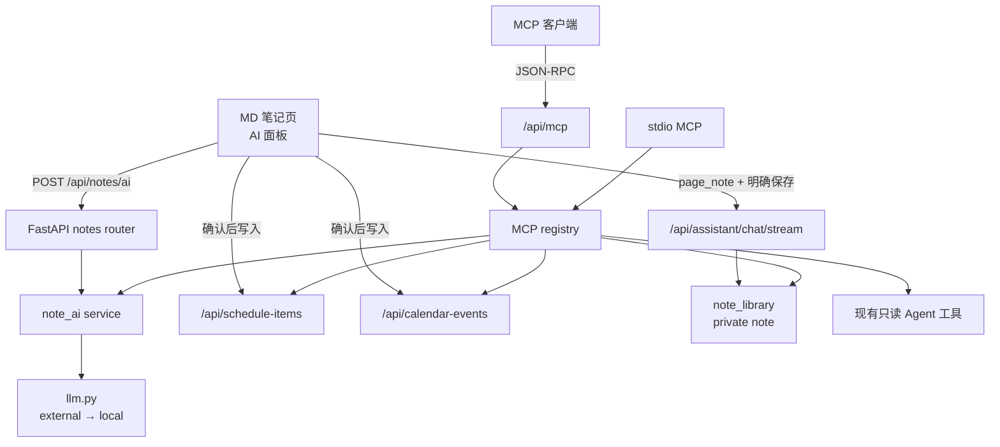

# ADR-0002：笔记 AI 与 MCP 能力层

## 状态

Accepted

## 背景

MD 笔记目前是纯前端资产：正文存在 IndexedDB 的 `p2m-md-notes-storage`，后端 `notes` 表里是另一套共享/私有笔记。两者不是同一份数据。

现在要给笔记加 AI 总结、润色、从正文抽取待办/日历动作，并且要求这套工具层能长期扩展。已有基础是：

- `backend/app/services/llm.py`：provider 配置、`build_chat_model`、`fallback_order`、`current_policy`。
- `backend/app/agents/tool_registry.py`：工具元数据、权限、超时、预算、熔断，但仅服务于 LangChain Agent。
- 待办和日历已有后端模型与接口：`ScheduleItem`、`CalendarEvent`。

必须先定清楚三件事：笔记正文怎么交给 AI、动作要不要直接写库、MCP 用什么形态接。

## 决策

### 1. 笔记 AI 走无状态请求体，不把 IndexedDB 同步到后端

新增 `POST /api/notes/ai`，请求体是 `action + title + markdown`。后端只读请求体、返回结果，不读也不写 IndexedDB，不把本地笔记写进 `notes` 表。

理由：

- MD 笔记的离线优先和自动保存是现有产品行为，强行同步会引入冲突、迁移和隐私边界。
- AI 只需要当前这篇正文，不需要笔记库全量。
- 以后如果要做跨设备笔记，单独加同步 ADR，不要让 AI 功能顺手改数据归属。

代价：本地 MD 笔记仍不自动同步，后端 `search_notes` 默认看不到它们。只有用户在聊天里明确要求“保存/总结后保存”时，前端才会把当前笔记副本随请求带上，由 `save_note` / `summarize_and_save_note` 写入 private 笔记；这是单向的显式保存，不是双向同步。

### 2. 动作探测只产生建议，写入必须由用户在界面上确认

`extract_actions` 返回结构化的 `todos` / `events`，不直接落库。前端逐条展示，用户点“加入待办”或“加入日历”后，复用现有接口：

- `POST /api/schedule-items`
- `POST /api/calendar-events`

MCP 侧可以提供 `notes_create_todo` / `notes_create_calendar_event`，但参数里强制 `confirm=true`，并在 tool annotations 标记 `destructiveHint`。模型不能凭一段笔记自动批量创建。

理由：笔记里出现“明天开会”不等于用户已经承诺创建日程；自动写库会把歧义放大成脏数据。

### 3. MCP 采用“注册表 + 双传输适配”，不把 LangChain tool 直接当 MCP

新增 `backend/app/mcp/`：

- `registry.py`：MCP 工具的唯一元数据源。每个工具声明 name / description / inputSchema / readOnly / destructive / handler。
- 现有只读 Agent 工具通过适配器导出，保留原有 `ToolSpec` 的权限和熔断语义。
- 笔记 AI、待办、日历作为首批原生 MCP 工具。
- `POST /api/mcp`：JSON-RPC over HTTP，支持 `initialize`、`tools/list`、`tools/call`，走登录态。
- `backend/scripts/mcp_stdio.py`：stdio 适配器，供本地 MCP 客户端拉起来；用 `MCP_USER_ID` 绑定用户。

不直接复用 `BaseTool` 的原因：LangChain tool 的 schema、错误模型和 MCP 的 `content/isError` 不是一套；直接把函数塞进 MCP 会在参数校验、错误脱敏、写操作确认上留下缺口。

理由：MCP 是协议边界，不是“再包一层函数”。注册表让后续增加笔记、日程、学习、视频工具时只改一个清单，并能单独做权限和审计。

### 4. 模型调用复用现有 LLM 服务，失败按 external → local 降级

笔记 AI 不新建模型客户端。沿用 `build_chat_model`、`fallback_order` 和超时/错误分类；每次调用消耗现有 AI 日配额，失败退回配额。AI 不可用时明确报错，不返回编造的摘要或动作。

### 5. 聊天助手保存当前 MD 笔记，只做显式单向复制

聊天请求新增可选 `page_note: {title, markdown}`，由前端在 MD 笔记页发送时填入当前笔记完整正文。它只作为本轮工具上下文，不写进提示词：

- `page_context` 仍只放前 800 字给模型看；
- 完整正文通过 `ContextVar` 交给 `save_note` / `summarize_and_save_note`；
- 只有用户明确说“保存/总结后保存”才挂载这两个写工具，且都要求 `confirm=true`；
- 保存结果写入后端 private notes，`source="assistant"`，不反向同步 IndexedDB。

这样既让聊天助手能处理“保存刚才笔记”，又不把本地笔记库悄悄搬进 `notes` 表。`note_create` 是同一写入能力在 MCP 侧的暴露，仍然强制确认。

## 架构

## 被否掉的方案

| 方案 | 否决原因 |
| --- | --- |
| 前端直接调模型 API | 密钥落在浏览器；超时、配额、降级、审计全部绕开 |
| 把 MD 笔记同步进 `notes` 表再让 AI 查 | 改变数据归属，冲突和迁移成本高；本轮不需要 |
| 用 MCP SDK 重写所有工具 | 现有工具治理层已经可用；全量重写会丢预算、熔断和权限语义 |
| 动作探测后直接创建待办/日历 | 误判成本高，用户没有确认机会 |
| 只做前端 prompt，不做 MCP | 后续扩展会重复实现鉴权、schema、错误处理 |

## 后果

正向：

- 笔记 AI 与本地存储解耦，刷新、离线、自动保存行为不变。
- 待办/日历写入有明确确认点，不会因为模型误判污染数据。
- MCP 工具有统一 schema 和 annotations，后续加工具不需要改协议层。

负向 / 需要接受：

- 本地 MD 笔记默认不在后端 `search_notes` 的检索范围；只有用户显式保存后，副本才会进入 private notes。没有双向同步，也没有自动保存。
- HTTP JSON-RPC 不是完整 MCP 传输规范；需要 stdio 适配器或后续补 SSE。
- 每次 AI 调用都有配额和延迟，前端必须提供 loading 与失败重试。
- `notes_create_todo` 在没有明确时间时只创建无排期待办，日期信息写入描述，不擅自占用日历时段。

## 后续

- 若要跨设备笔记，单独设计同步与冲突解决，不在本 ADR 里扩。
- 若要接更多 MCP 客户端，优先补 SSE / Streamable HTTP 会话，而不是继续加自定义 REST 路由。
- 所有新增 MCP 写工具必须自带 `confirm` 与审计字段。
