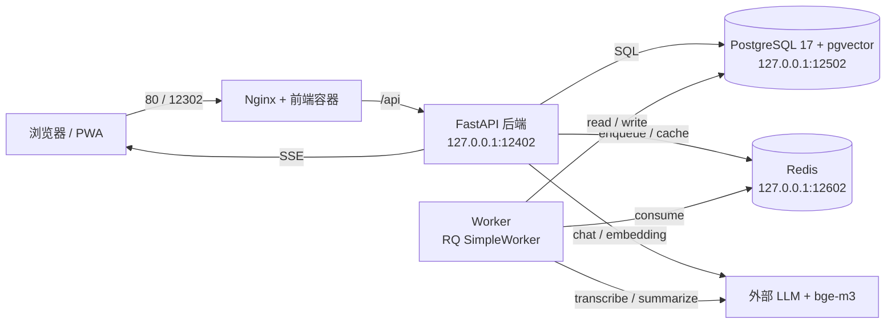
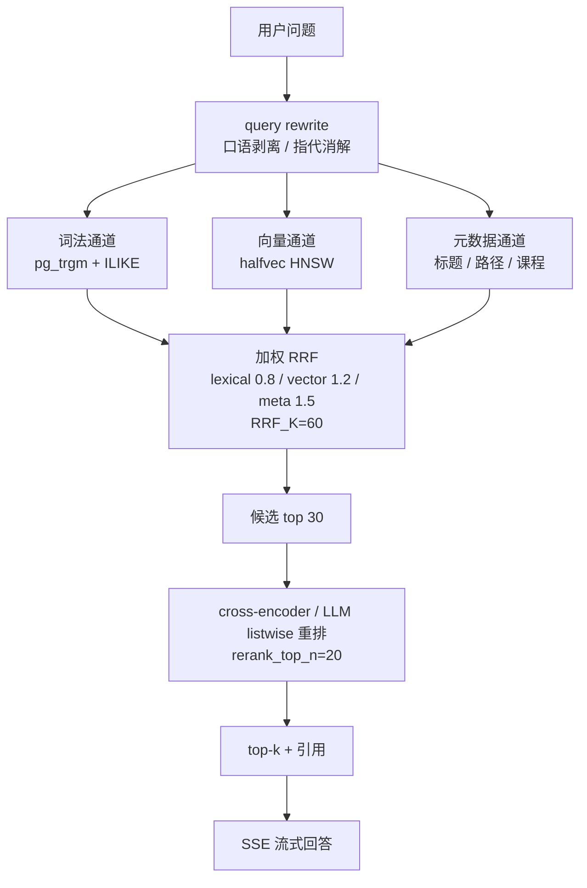
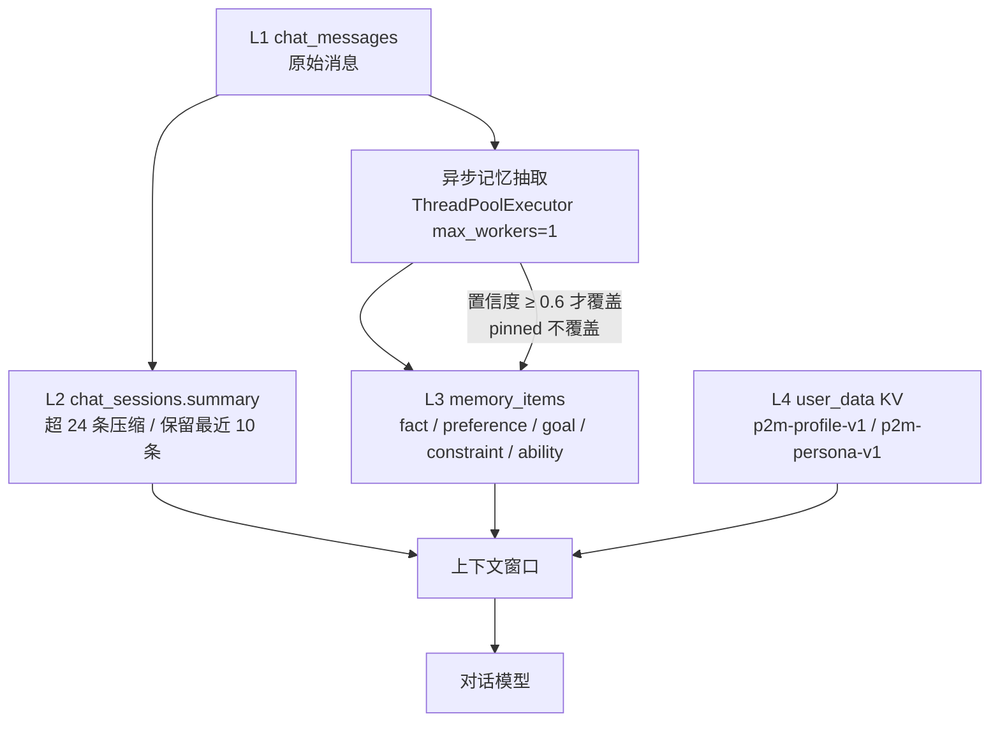
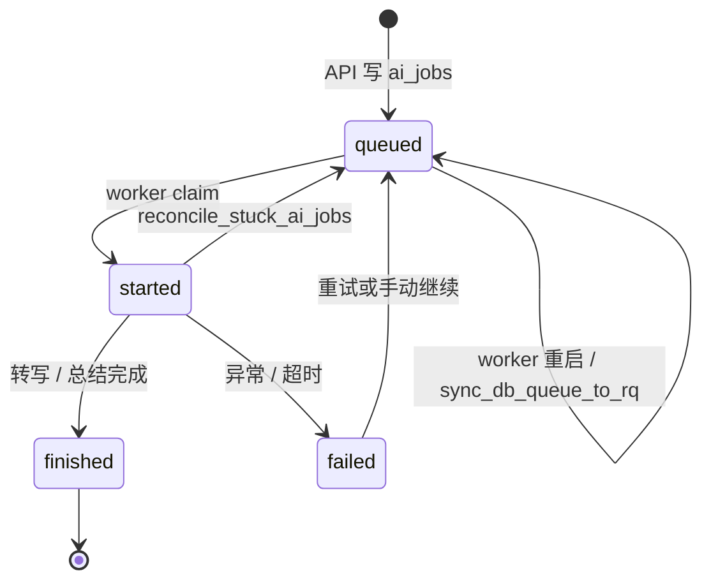
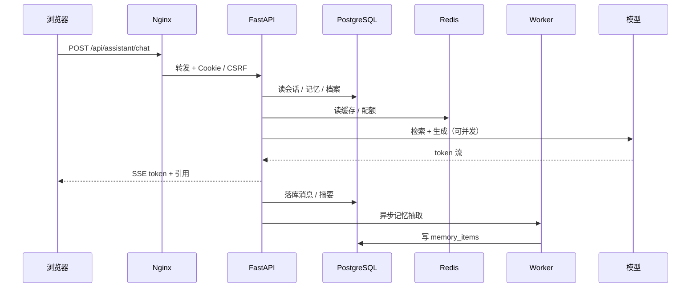

# P2 架构图集（Mermaid）

> 状态：现行（2026-11-16）。这些图用于 README、幻灯片或 GitHub 预览；可交互版见 [architecture-demo.html](architecture-demo.html)。

## 1. 五服务部署

## 2. 三路检索与重排

## 3. 四层记忆

## 4. 任务状态机

## 5. 一次对话请求时序

## 6. 端口与资源（文本版）

| 服务 | 宿主端口 | 容器端口 | 腾讯云上限 |
|---|---:|---:|---|
| frontend | `80`、`12302` | `80` | 256m / 1 CPU |
| backend | `127.0.0.1:12402` | `8000` | 3g / 2 CPU |
| worker | 不映射 | — | 跟随 backend 覆盖层 |
| postgres | `127.0.0.1:12502` | `5432` | 2g / 2 CPU |
| redis | `127.0.0.1:12602` | `6379` | 512m / 1 CPU |
| 监控 | 预留 `12702` | — | 未部署 |
