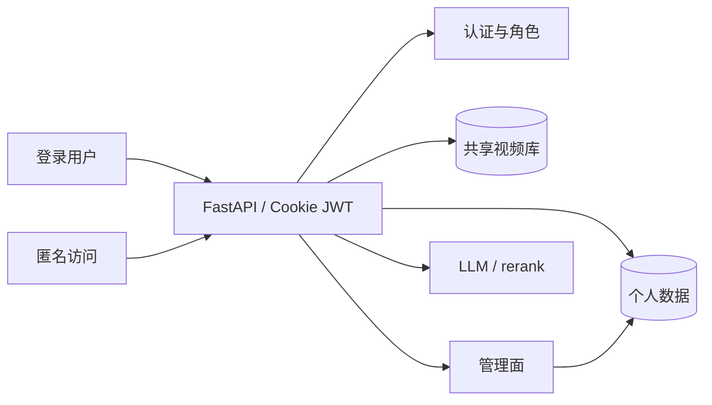

# P2 多用户架构评审：身份、权限边界、数据隔离与配额

> 2026-11-17 修复状态：P1/P2 已全部落地，验证记录见 `multi_user_p1p2_fix_2026-11-17.md`；P0 的 `demo` 管理员按用户要求保留，P3 本轮未动。

日期：2026-11-17  
范围：`backend/app/models.py`、`auth.py`、`routers/*`、`agents/tools.py`、`services/profile.py`、`services/quota.py`、`services/rate_limit.py`、`scripts/test_multi_user.py`，以及当前 PostgreSQL / 运行态数据。  
性质：只读评审；本轮不修改多用户代码，不覆盖 `docs/multi-user-report.md` 的历史诊断结论。

## 结论先说

多用户隔离的主框架已经成立：共享视频库、私有笔记、观看进度、会话、记忆、目标/路径、`user_data`、日程和日历都有明确的归属键；`chat_sessions` 的无主会话问题已经修过，配额键和限流键也按用户/IP 生成。

但这一轮仍然找到几类没有收口的边界：

1. **管理面存在一个“已知口令的管理员”**。`demo` 账号是 admin，演示文档里仍保留固定登录口令，本轮验证该口令仍可登录。只要站点在局域网或公网可达，拿到仓库/演示文档的人就能进入管理面。这是当前最优先的身份问题。
2. **Agent 推荐工具存在真实的跨用户串数据**：`recommend_next_videos` 的观看历史、学习目标、画像都没有按当前用户过滤。当前库中 user 1 有 145 个看过的视频、3 个目标；user 32 有 56 个看过的视频、1 个目标，两边会互相影响推荐结果。
3. **无主数据的读取规则仍不一致**：`agent_runs` 还有 12 条 `user_id IS NULL`，`get_run` 对空归属直接放行，普通成员可以读到已完成的旧运行；`learning_paths` 当前 0 条空归属，但 `_load_path_for_user` 的规则同样会在未来产生空归属时放行。
4. **共享资源的写边界没收口**：收藏仍是 `videos.is_favorite` 全局字段，任何成员登录后都能改；观看进度接口还能顺手写共享视频的 `duration`。
5. **AI 成本入口没有纳入配额**：`/api/search/hybrid` 和 `/api/videos/search/segments` 无登录依赖、默认开启 rerank，rerank 会走外部 LLM；`/api/notes/ai-daily` 也没有配额/限流。现有 quota 只覆盖 chat 和 plan。
6. **删除语义不完整**：删私有笔记只删 DB 行，不删 `work_dir/user-notes/{user_id}/note-{id}.md`；删用户也不清该用户目录和 `AgentRun`。

历史报告的 `15/15` 仍然只对当时覆盖的路径成立。它的隔离矩阵把 `agent_runs` 标成 `✓`，但当前实际有 12 条空归属；`admin` 用户名账号当时写“role=member、待复核”，现在已经是 admin。这两条需要在新报告里修正。

---

## 一、当前模型与基线

### 1.1 信任边界



当前设计不是“所有数据按用户分库”，而是“共享知识库 + 个人派生状态”：

- **共享**：`videos`、`categories`、`subtitle_segments`、`content_chunks`、向量、AI 生成的 `shared` 笔记。
- **私有**：`watch_history`、`watch_events`、`chat_sessions`、`memory_items`、`user_data`、`schedule_items`、`calendar_events`、`user_profiles`、`learning_goals`、`learning_paths`、`agent_runs`、`private` 笔记。
- **混合**：`notes` 通过 `scope` 区分共享和私有；`videos.is_favorite` 名义上是视频库字段，实际被当成用户收藏使用。

### 1.2 当前数据库快照

2026-11-17 通过 `p2-siteyeb-postgres-1` 实测：

| 表 | 总量 | 空归属 / 备注 |
|---|---:|---|
| `users` | 22 | 3 个 admin：`yeb123`(id=1)、`admin`(id=6)、`demo`(id=32) |
| `agent_runs` | 78 | **12 条 `user_id IS NULL`**；10 条 completed、2 条 running，均为 2026-11-15 |
| `chat_sessions` | 120 | 0 条空归属 |
| `learning_goals` | 4 | 0 条空归属 |
| `learning_paths` | 5 | 0 条空归属；user 1 有 4 条、user 32 有 1 条 |
| `memory_items` | 16 | 0 条空归属 |
| `notes` | 9,364 | 9,360 条 shared、空归属；4 条 private，属于测试账号 47/49/52/54 |
| `watch_history` | 218 | 0 条空归属；user 1 有 160 行/145 个视频，user 32 有 58 行/56 个视频 |
| `watch_events` | 9,016 | 0 条空归属 |
| 收藏 | 0 | `videos.is_favorite` 当前无数据，缺陷处于潜伏状态 |

### 1.3 已经成立、不应被本轮否定的部分

- `notes` 的 `scope=shared/private` 已落地；`private` 只有本人可读写，`shared` 所有登录用户可读、只有 admin 可改。
- `chat_sessions` 已按 `user_id` 隔离；无主会话只有 admin 可读，这是上一轮修过的真实漏洞。
- `watch_history` 的读取已按当前用户过滤；匿名用户看到的是“没有进度”，不是“所有人的进度”。
- `user_data`、`schedule_items`、`calendar_events`、`memory_items`、`learning_goals`、`learning_paths` 的常规查询都带 `user_id`。
- 配额键形如 `quota:{name}:{user_id}:{YYYYMMDD}`；chat / plan 按角色乘倍率；限流覆盖登录、注册、chat、plan。
- 认证侧已具备 PBKDF2、旧 SHA-256 透明升级、JWT `token_version`、httpOnly Cookie、`SameSite=lax`、CSRF Guard、CORS 白名单、注册默认关闭、管理端 router 级 `require_admin`。

这些是基线，不应该因为下面几条问题被整体推翻。

---

## 二、本轮新发现与优先级

### P0-1：`demo` 是管理员，且演示文档里的固定口令仍能登录

**证据**

- `users` 表 `demo` 的 `id=32`、`role=admin`、`is_active=true`。
- `docs/demo-video-script.md` 仍保留固定登录口令。
- 本轮实际用该口令登录 `demo`，`/api/auth/me` 返回 `role=admin`；不在本报告中复述口令。

**影响**

只要站点在局域网/公网可达，任何拿到仓库或演示文档的人都能以管理员身份：

- 修改全局助手/模型设置、触发扫描/转写/清空队列等重活；
- 管理用户、改角色、停用/删除账号；
- 读取任意已知 session / AgentRun（`_load_session_for_user` 和 `get_run` 对 admin 放行）；
- 修改共享视频库的运营字段（收藏、共享笔记等）。

这已经不是“多用户隔离”问题，而是**管理面可被接管**。即使 `demo` 最初只是演示账号，放在有真实用户数据的环境里也不应该保留 admin 权限和公开口令。

**建议**

1. 立即轮换 `demo` 口令，或直接停用该账号；
2. 演示需要账号时，建独立的 `demo-member`，只赋予共享库只读权限，不给 admin；
3. 演示环境与真实数据环境分离；
4. 删除文档中的明文口令，改为环境变量/一次性邀请；
5. 清点 3 个 admin：只保留确有必要的一个 owner admin，`demo` 和测试期 `admin` 都不应长期保留管理权限。

---

### P1-1：`recommend_next_videos` 未按用户过滤，A 的推荐会吃 B 的目标和观看历史

**证据**

`backend/app/agents/tools.py`：

- 第 281-283 行：`watched_ids` 直接查 `WatchHistory.video_id`，没有 `user_id` 过滤；
- 第 290-296 行：`goals` 直接查所有 `LearningGoal.status == "active"`，没有 `user_id` 过滤；
- 第 346 行：画像兜底显式传 `get_profile_data(db, None)`，会经 `resolve_user_id` 落到最早创建的用户（当前是 id=1）。

当前数据正好能证明这不是理论问题：

- user 1：160 条观看记录 / 145 个不同视频，3 个目标；
- user 32：58 条观看记录 / 56 个不同视频，1 个目标。

对 user 32 调用推荐时，`watched_ids` 会把 user 1 看过的 145 个视频也排除；`goal_skills` 会混入 user 1 的目标技能；兜底画像则直接读 user 1 的画像。反过来，user 1 也会被 user 32 的 1 个目标影响。

**建议**

在函数入口取当前用户，并把“必须有 uid”作为硬约束：

```python
uid = _uid()
if uid is None:
    return "请先登录后再让我推荐。"

watched_ids = {
    row[0]
    for row in db.query(WatchHistory.video_id)
    .filter(WatchHistory.user_id == uid)
    .distinct()
    .all()
    if row[0]
}

goals = (
    db.query(LearningGoal)
    .filter(LearningGoal.user_id == uid, LearningGoal.status == "active")
    ...
)

profile = get_profile_data(db, uid)
```

`recommend_next_videos` 在 `tool_registry.py` 里已经 `requires_login=True`，但函数体没有用 `_uid()`；这说明 spec 的登录约束不能代替函数内部的数据过滤。同类工具 `get_recent_activity`、`get_learning_goal`、`get_learning_profile` 已有 uid 条件，应统一成同一种写法，避免以后新增工具再漏。

---

### P1-2：无主 `AgentRun` 对普通成员放行，12 条旧运行是现实存量

**证据**

`backend/app/models.py:505-529` 的 `AgentRun.user_id` 可空，且没有外键；当前 12 条空归属，10 条已完成、2 条 running，均建于 2026-11-15。

`backend/app/routers/learning.py:354-362`：

```python
if run.user_id is not None and run.user_id != user.id and (user.role or "") != "admin":
    raise HTTPException(404, "任务不存在")
```

`run.user_id is None` 时直接跳过判断。`get_run` 虽然不返回 `input_text`，但会返回 `output_text` 解析后的 `result`；已完成的 plan run 输出可达 6,000+ 字符，chat run 也会包含对话结果。

本轮用普通成员 `isolation-test-a` 对一个已完成的无主 plan run 发起 `GET /api/learning/runs/{run_id}`，实际返回 **200**，不是 404。这说明不是“需要管理员才可利用”，而是登录成员就能读。

`learning_paths` 当前 0 条空归属，但 `_load_path_for_user` 第 156-163 行是同一套 `if path.user_id is not None and ...` 规则；`plan_agent.node_persist` 第 278 行又允许 `owner_id = int(state.get("user_id") or 0) or None`，未来只要有一次内部调用没带用户，就会生成一条空归属路径，然后被任何成员读到。

**建议**

1. 代码侧：`user_id is None` 一律仅 admin 可读；普通成员 404。`get_run` 和 `_load_path_for_user` 都要改。
2. 数据侧：给 12 条旧 `AgentRun` 做归属回填（归 owner/admin）或标记为 `legacy/quarantine`；不要保留“空 = 公共”。
3. 写入侧：`plan_agent.node_persist` 在 `owner_id` 为空时直接失败，不允许落空归属；`AgentContext.user_id` 对 chat 路径也应要求非空。
4. 迁移侧：`migrations._claim_legacy_ownership()` 目前只回填 `watch_events`、`watch_history`、`learning_goals`、`learning_paths`（约 67-71 行），没有 `agent_runs`；补上，或在迁移中明确“空 AgentRun 归 owner”的策略。

---

### P1-3：删除私有笔记只删 DB 行，磁盘文件仍保留

**证据**

`backend/app/routers/notes.py:52-59` 把私有笔记写到：

```text
work_dir/user-notes/{user_id}/note-{id}.md
```

`notes.py:174-186` 的 `delete_note` 只执行 `db.delete(note)`，没有 `unlink`。`admin.py:514` 删除用户时也只 `db.query(Note).filter(...).delete()`，没有清理目录。

本轮在 backend 容器内实际看到：

```text
/data/work/user-notes/32/note-9603.md  20 bytes
```

而 `notes` 表中 `id=9603` 已经不存在。这说明“用户删除笔记”后文件仍在磁盘，属于**删除语义不完整**；当前 private 笔记只有 4 条测试账号数据，所以影响面有限，但设计上是明确的隐私保留问题。

`admin.delete_user` 也没有删除 `AgentRun`；`AgentRun` 又是完整对话/规划输出，属于“审计保留还是删除”的产品决策，不能靠遗漏决定。

**建议**

1. `delete_note` 在 DB 删除成功后，按 `_private_note_path(note)` 重新计算路径并 `unlink`；不要直接信任 DB 里的 `markdown_path` 去删任意路径。
2. `delete_user` 在删除 Note 行后，清理 `work_dir/user-notes/{user_id}` 整个目录；路径先 `resolve()` 并确认位于 `work_dir` 下，再做递归删除。
3. 对 `AgentRun` 明确策略：
   - 审计保留：保留但脱敏/限制读取，设置 30/90 天保留期；
   - 隐私删除：随用户删除；
   - 折中：保留统计字段，删除 `input_text/output_text` 正文。
4. 把“用户删除”从手工删除多个表改成集中的 `delete_user_data` 服务，避免以后新增表再次漏项；`AgentRun` 和私有笔记文件这次就是漏项。

---

### P1-4：匿名可触发 LLM rerank，AI 成本入口没有配额

**证据**

- `backend/app/routers/search.py:35-52` 的 `/api/search/hybrid` 没有 `Depends(get_current_user)`；`rerank` 默认 `True`。
- `backend/app/routers/videos.py:140-166` 的 `/search/segments` 没有鉴权；固定 `use_rerank=True`。
- `backend/app/services/hybrid_search.py:215-254` 的 `_llm_rerank` 明确使用 `build_chat_model("external")`；专用 reranker 不可用时也会回退到 LLM listwise。
- `quota.py` 只有 `chat_quota_for` / `plan_quota_for`；`rate_limit.py` 只有 login / register / chat / plan；搜索和 rerank 没有配额或限流。
- `backend/app/routers/notes.py:80-87` 的 `/api/notes/ai-daily` 只要求登录，没有 quota/limiter；`daily_digest.py:291-300` 会依次尝试 `external` / `local` 模型。

**影响**

任何匿名访问者都可以反复请求混合检索/片段搜索，触发外部 LLM rerank。如果配置了外部 API Key，这会直接消耗费用；如果指向本地 LM Studio，则会占满 GPU 队列，拖慢聊天、向量化和转写。即使视频库允许匿名浏览，**匿名 + 默认 rerank + 无配额**的组合也不应该保留。

**建议**

1. 对 rerank/search 加登录依赖；如果匿名搜索是产品需求，匿名路径强制 `use_rerank=False`，只走词法/向量召回。
2. 新增 `ai_search` 每日配额（按用户）和每分钟限流；管理员倍率复用现有 `quota_admin_multiplier`。
3. `ai-daily` 按“每用户每天一次”缓存或配额，避免同一用户反复生成。
4. 如果后续还有新的 LLM 入口，统一走一个 `llm_cost_guard`，不要每个路由各写一套；当前 chat/plan 有配额，search/digest 没有，说明“按入口补”已经开始漏。

---

### P1-5：收藏是全局字段，成员登录即可改所有用户看到的收藏状态

**证据**

- `backend/app/models.py:86-87`：`Video.is_favorite` / `favorited_at` 在 `videos` 表上。
- `backend/app/routers/videos.py:574-589`：`POST /api/videos/{video_id}/favorite` 要求登录，但直接改 `video.is_favorite`。
- `serialize_video` 和 `recommend_next_videos`（第 361 行 `order_by(desc(Video.is_favorite), ...)`）都把这个全局字段当用户偏好使用。

当前 `favorite` 数据为 0，所以没有实际越权样本；但语义是错的：A 点收藏，B 的列表和推荐排序一起变。这不是“共享库运营标记”的行为，而是“个人收藏”的入口。

**建议**

二选一，不能维持现状：

- **个人收藏**：新增 `user_video_favorites(user_id, video_id, favorited_at)`，主键 `(user_id, video_id)`，接口按当前用户查/写；列表、继续观看、推荐、播放列表都改成 join 当前用户。
- **共享运营标记**：把字段改名为 `library_featured` / `curated`，接口改为 `require_admin`，并在 UI 上明确“精选/推荐”，不要叫收藏。

从现有前端语义和用户预期看，个人收藏更合理；新表也能顺带解决“收藏时间按用户不同”的问题。

---

### P2-1：普通成员可以通过进度上报改共享视频 `duration`

**证据**

`backend/app/routers/videos.py:505-517`：

```python
if not video.duration and payload.duration:
    video.duration = payload.duration
```

`save_watch_history` 只要求登录，不要求 admin。任何一个成员在视频 `duration` 为空时上报一个值，就会改掉共享库的元数据；后续完成率、播放器总时长、推荐时长都会受影响。

**建议**

视频元数据只允许导入流程或 admin 写；`save_watch_history` 不要顺手改 `videos.duration`。如果播放器确实发现了真实时长，写入单独的“待确认时长”字段，由后台校验后合并。

---

### P2-2：admin 能读任意会话/AgentRun，但不能读 private 笔记，边界不一致

**证据**

- `backend/app/routers/assistant.py:141-156`：`_load_session_for_user` 对 admin 放行任意用户会话。
- `backend/app/routers/learning.py:354-362`：`get_run` 对 admin 放行任意用户 AgentRun。
- `backend/app/routers/notes.py:46-48`：private 笔记明确“admin 也不行”。

这不是代码错误，而是**权限模型没有定义清楚**：admin 到底是“系统运维角色”，还是“可以看所有内容的 owner”？当前是两者的混合体。

在单机、单 owner 的本地部署里，admin 读全库可以接受；但在多人协作/多租户里，admin 读别人的私聊和 AgentRun 会成为隐私争议点。更麻烦的是 `demo` 现在是 admin，见 P0-1。

**建议**

- 如果产品定位是“单机个人知识库，admin=owner”：在权限文档里明确写出“admin 可读全库个人内容”，并限制 admin 账号数量；private 笔记要么也允许 owner 读，要么把“admin 不能读 private 笔记”写成明确例外。
- 如果未来要多人协作：admin 只保留运营权限（用户管理、任务、共享库），个人会话/AgentRun/路径的读取改为 owner 本人 + 显式 break-glass（审计日志、二次确认）。
- 无论哪种，管理面读取个人内容应记录审计（谁、何时、读了哪个 session/run），当前没有这类日志。

---

### P2-3：可空归属 + 迁移不完整，是空归属问题的根因

**证据**

- `AgentRun.user_id`、`LearningPath.user_id`、`MemoryItem.user_id`、`ChatSession.user_id`、`Note.user_id` 都是 nullable。
- `migrations._claim_legacy_ownership()` 只覆盖 4 张表，不含 `agent_runs` / `chat_sessions` / `memory_items`；当前 `chat_sessions` 0 空、`memory_items` 0 空，但 `agent_runs` 12 空。
- 代码对空归属的处理不统一：
  - `chat_sessions`：空归属仅 admin；
  - `learning_paths` / `agent_runs`：空归属所有登录成员；
  - `notes`：`shared` 空归属所有登录用户，`private` 空归属谁都看不到（`note.user_id != user.id` 对 None 永远为真）。

**建议**

1. 先定一条硬规则：**“空归属”不是“公共”，而是“未迁移/隔离区”**。除 `Note.shared` 这种明确的共享语义外，personal 表空归属一律 admin-only 或不可读。
2. 做完数据回填后，对 `watch_history`、`chat_sessions`、`memory_items`、`learning_goals`、`learning_paths` 加 `NOT NULL`（或至少在应用层禁止写空）；`AgentRun` 如果允许“系统任务无主”，也要有显式 `system` 标记，而不是 null。
3. 把迁移函数补全，并在启动时记录“还有多少 null 未处理”；不要静默跳过。
4. `Note.user_id` 保留 nullable 是合理的（shared 需要 null），但应加约束：`scope='private'` 时 `user_id IS NOT NULL`；否则私有笔记的空归属会变成“谁都读不到”的僵尸数据。

---

### P2-4：配额扣减发生在去重/并发/失败之前，`refund()` 没有调用方

**证据**

`backend/app/routers/learning.py:257-265` 在 `plan_limiter` 和 `plan_quota` 之后才去重、检查 `MAX_INFLIGHT`、创建 run；`quota.py:78-85` 的注释直接写明“目前没有任何调用方”，并列出三条会白扣额度的路径：去重命中、并发 429、生成失败。

chat 路径同样是先 `consume` 再调用模型；模型失败时也没有 refund。

**建议**

- 去重命中、`MAX_INFLIGHT` 429、生成失败三条路径调用 `refund`；
- 或者把 consume 移到“确定要真正执行”之后；
- chat 失败是否退还可按产品定义，但至少要在日志/用量里区分“尝试”和“成功”，否则管理员看到的每日用量会虚高。

---

### P2-5：画像摘要仍按旧语义写“全库笔记”，会把私人笔记数说成库内笔记数

**证据**

`backend/app/services/profile.py:386-390` 仍写着：

```python
# Note 表没有 user_id：它是 AI 转写产物，属于共享视频库。
parts.append(f"视频库内已有 {data['notes_count']} 篇转写笔记（全库统计，非个人记录）")
```

但 `recompute_profile` 第 289-295 行已经改成只统计本人 `private` 笔记。现在 `notes_count=3` 表示“你写了 3 篇私有笔记”，摘要却告诉 LLM “视频库内已有 3 篇转写笔记”。模型很容易回答成“库里有 3 篇 AI 笔记”，而不是“你记录了 3 篇”。

**建议**

改成：

```text
你已记录 {n} 篇私人笔记
```

如果还要保留共享笔记数量，单独查 `scope='shared'` 并写成“视频库共有 N 篇 AI 转写笔记”，不要和 `notes_count` 混用。

---

### P3-1：长度/存储/匿名写入缺少上限

- `UserDataItem.value`（`schemas.py:437-438`）、`NoteCreate.content` / `NoteUpdate.content`（`schemas.py:282/293`）没有长度上限；成员可以往 DB/磁盘写超大文本，当前没有按用户存储配额。
- `POST /api/watch-events` 允许匿名，单批最多 200 条，但没有 IP 限流；匿名脚本可以持续灌入事件，污染统计并增长表。
- `GET /api/videos` 的 `page_size` 上限是 999999（`videos.py:219`）；匿名列表接口可以被用来拉大页。
- `GET /api/videos/{video_id}/sprite`（`videos.py:715-755`）无鉴权，首次请求会跑几十次 ffmpeg 抽帧；匿名用户可以按视频 id 触发共享资源消耗。

**建议**

给 `user_data` / note 内容加合理的字符上限；给 watch-events 加每 IP 限流；`page_size` 收到 100/200；sprite 只服务已生成的图，生成动作要求登录/admin 或后台任务。

---

### P3-2：logout 只清 Cookie，JWT 仍可用到过期

`auth.py` 的 `logout` 只 `clear_session_cookie`；JWT 默认 12 小时，`token_version` 只在改密码/停用/重置密码时递增。浏览器“退出登录”后，旧 token 在有效期内仍可用。

本地单机可以接受；如果站点对局域网/公网开放，建议至少给高权限账号加“会话撤销/短 TTL”，或在 logout 时把 `jti` 写入 Redis 黑名单。`demo` 管理员账号更应优先处理。

---

### P3-3：测试账号与固定测试口令仍在库里

`test_multi_user.py` 使用固定账号 `isolation-test-a/-b` 和固定口令，当前 `users` 22 个，存在大量 `isoauto*` / `isolation-test-*` / `verify-migrate-*` 测试账号。它们不是安全漏洞，但会污染管理面、占用用户名，并且固定测试口令本身也是“已知凭据”。

建议测试结束清理账号，或把隔离测试放到独立测试库；CI 中使用一次性账号并显式清理。

---

## 三、数据隔离矩阵（本轮复核）

| 域 | 存储 | 当前规则 | 判断 |
|---|---|---|---|
| 视频/分类/字幕/语义块/向量 | `videos` 等共享表 | 所有登录用户可读，写操作多数 admin/导入 | 共享合理；匿名读边界待定 |
| AI 共享笔记 | `notes.scope='shared'` | 所有登录用户可读，admin 可改 | 合理 |
| 私人笔记 | `notes.scope='private'` | 仅本人；admin 也不行 | 合理但删除文件不彻底 |
| 观看进度 | `watch_history` | 按 `user_id` 读写 | 合理 |
| 观看事件 | `watch_events` | 登录绑定 user；匿名写 null | 统计可接受，缺匿名限流 |
| 会话/消息 | `chat_sessions` / `chat_messages` | 按 user；空归属仅 admin | 合理，admin 可读任意 |
| 长期记忆 | `memory_items` | 按 user；空归属对普通成员不可见 | 合理 |
| 用户 KV | `user_data` | 按 user | 合理 |
| 日程/日历 | `schedule_items` / `calendar_events` | 按 user | 合理 |
| 画像 | `user_profiles` | 按 user；Redis key 按 user | 合理 |
| 学习目标/路径 | `learning_goals` / `learning_paths` | 常规查询按 user；空归属路径放行 | **空归属规则需收紧** |
| Agent 审计 | `agent_runs` | 常规按 user；空归属放行 | **12 条空归属，需收紧** |
| 收藏 | `videos.is_favorite` | 全局字段，成员可写 | **语义错误** |
| 管理面 | `/api/admin/*` | router 级 admin | 路由保护成立，但 `demo` 削弱了它 |

---

## 四、关键决策建议（ADR 摘要）

### ADR-001：管理面与演示账号分离

**Status：Proposed（本轮最优先）**  
**Context**：`demo` 是 admin，演示文档保留固定口令；管理面能读任意已知 session/AgentRun、改配置、管用户。  
**Decision**：真实数据环境不允许存在“公开口令的管理员”；演示账号降为 member 且只读共享库；演示环境独立。  
**Alternatives**：保留 demo admin 但轮换口令并限制来源 IP；或把 demo 放到单独的演示数据库。  
**Consequences**：演示视频/截图需要重新用只读账号录制；管理员数量变少，运维更清晰。

### ADR-002：收藏改为用户级关联表

**Status：Proposed**  
**Context**：`Video.is_favorite` 是共享字段，但产品语义是个人收藏。  
**Decision**：新增 `user_video_favorites(user_id, video_id, favorited_at)`，接口按当前用户读写；`serialize_video`、列表、推荐、播放列表都按当前用户 join。  
**Alternatives**：保留全局字段但改名 `library_featured` 并要求 admin 写。  
**Consequences**：多一张小表、查询多一个 join；换来正确的多用户语义和可迁移的收藏时间。

### ADR-003：admin 的内容访问边界

**Status：Proposed / 需产品确认**  
**Context**：admin 能读任意会话/AgentRun，却不能读 private 笔记；`demo` 又是 admin。  
**Decision（单机 owner 模式）**：明确 admin=owner，可在紧急情况下读个人内容，但要有审计和账号最小化；private 笔记的例外要么取消，要么写进权限文档。  
**Decision（多人协作模式）**：admin 只做运营，个人内容读取需 owner 本人或 break-glass。  
**Consequences**：影响管理端 UI、审计日志、未来的多租户设计；需要在产品定位确定后一次改清。

### ADR-004：空归属不是公共

**Status：Proposed**  
**Context**：`AgentRun` 12 条空归属被成员读到；`LearningPath` 的代码规则同样会放行。  
**Decision**：个人表空归属默认 admin-only 或不可读；迁移回填后加非空约束；`AgentRun` 如允许系统任务，使用显式 `system` 标记而不是 null。  
**Alternatives**：保留 null 但每个读接口单独判断（当前做法，已经漏了）。  
**Consequences**：需要一次数据回填和迁移；旧数据可能无法确定归属，需要 owner/admin 决策。

### ADR-005：删除与保留策略

**Status：Proposed**  
**Context**：删除私有笔记/用户不清理磁盘文件；AgentRun 未删除也无保留期。  
**Decision**：private 笔记文件随笔记/用户删除；AgentRun 按审计保留策略（例如 30/90 天或脱敏保留），在删除用户时明确处理。  
**Consequences**：需要统一的用户数据生命周期服务，不再在 `delete_user` 里手工枚举表。

### ADR-006：AI 成本统一预算

**Status：Proposed**  
**Context**：chat/plan 有配额，search/rerank、ai-daily 没有；匿名 rerank 可触发外部 LLM。  
**Decision**：所有会调用 LLM 的入口统一走 `llm_cost_guard`（登录、限流、每日配额）；匿名搜索强制关闭 rerank。  
**Consequences**：搜索页匿名体验会下降；需要产品确认视频库是否公开。

---

## 五、修复顺序

本轮只评审，不建议现在直接改代码；下一轮按下面顺序做，先收安全口，再做体验：

| 顺序 | 事项 | 优先级 | 依赖 |
|---:|---|---|---|
| 1 | 轮换/停用 `demo`，清理演示文档口令，演示账号降 member | P0 | 无 |
| 2 | `get_run` / `_load_path_for_user` 空归属收紧；12 条 AgentRun 回填/隔离 | P1 | 迁移策略 |
| 3 | `recommend_next_videos` 按 `_uid()` 过滤观看、目标、画像 | P1 | 无 |
| 4 | 私有笔记删除文件；删用户清目录；明确 AgentRun 保留 | P1 | ADR-005 |
| 5 | 收藏改用户级表，或改 admin-only 运营标记 | P1 | ADR-002 |
| 6 | search/rerank 加登录/配额/限流；匿名 rerank 关闭 | P1 | ADR-006 |
| 7 | 共享视频 `duration` 改为 admin/导入写 | P2 | 无 |
| 8 | 明确 admin 内容访问边界；补审计 | P2 | ADR-003 |
| 9 | 补全迁移 + 非空约束；统一空归属规则 | P2 | ADR-004 |
| 10 | 配额 refund / 搜索与 ai-daily 配额；画像摘要文案修正 | P2 | 无 |
| 11 | 长度/存储上限、watch-events 限流、page_size/sprite 收口 | P3 | 无 |
| 12 | 测试脚本清理账号、接 CI、补隔离用例 | P3 | 上述改动 |

**验证建议**：每项至少加一个能区分旧行为的测试；不要只跑现有 15 项。最低新增用例：

- A 收藏后，B 的收藏状态和推荐排序不变；
- A 问“推荐下一步”时，输出不包含 B 的目标技能，也不排除 B 看过的视频；
- 普通成员读无主 AgentRun/Path 返回 404；admin 可以读；
- 删除私有笔记后文件不存在；删除用户后 `user-notes/{user_id}` 不存在；
- 匿名请求 search/rerank 返回 401 或强制无 rerank；配额超限返回 429；
- `demo` 不再是 admin（或账号不存在）；
- 共享视频 `duration` 不能被普通成员改写。

---

## 六、测试与证据边界

本轮实际做了这些只读验证：

| 检查 | 结果 |
|---|---|
| 12 条无主 `AgentRun` | 已确认；2 running、10 completed |
| 普通成员读无主 plan run | **HTTP 200**，不是 404 |
| `demo` 固定口令登录 | **成功，role=admin**；本报告不复述口令 |
| 匿名读 `/api/videos/{id}/notes` | 401 |
| `/api/search/hybrid` 的代码 | 没有 `get_current_user`；默认 `rerank=True` |
| 私有笔记文件残留 | `/data/work/user-notes/32/note-9603.md`，DB 已无对应行 |
| 收藏 | 当前 0 条，缺陷未触发 |
| 空归属路径 / 会话 / 记忆 | 当前 0 条；规则仍不一致 |

未做/未覆盖：

- 没有跑完整 `test_multi_user.py`。历史 15/15 仍可作为已覆盖路径的基线，但不能证明本轮新增边界。
- 没有实际调用带 rerank 的匿名搜索（会消耗模型/GPU，不适合在评审中做压力测试）；结论来自路由和 `_llm_rerank` 代码。
- 没有修改任何代码或数据；没有清理测试账号或孤儿文件。
- 数据库数字是 2026-11-17 快照；批量转写/向量化期间会变化。

## 一句话总结

**当前最该做的不是再加多用户表，而是先把“管理面身份”收口：停掉公开口令的 demo admin，堵住无主 AgentRun，修正推荐工具的跨用户过滤；然后再处理收藏、私有笔记文件和公开 rerank 这三个边界。**
